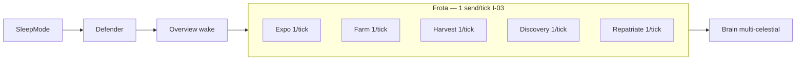

# IMPROVEMENTS.md — pontos de melhoria

Backlog técnico (não é épico de produto). Fonte de features: [`FEATURES.md`](../FEATURES.md). Arquitetura: [`AGENTS.md`](../AGENTS.md).

Checkpoint transport paralelo (E04-T05 + follow-ups): [`TRANSPORT_BUNDLE.md`](TRANSPORT_BUNDLE.md).

Snapshot da análise (2026-10-30). Atualizar status aqui quando fechar um item.

**Legenda:** `todo` · `doing` · `done` · `skip`

---

## Manter

- Pick Page-free vs I/O em AutoMine / AutoResearch / LF (`*_pick.py`)
- `compose.build_runtime` + `Runtime.run_once` / `wake` / sleep gate
- Fleet stack fatiado (`fleet_ajax` / `fleet_dispatch` / `fleet_ui`)
- Control plane fora do Brain (`control` / `focus` / TUI / Telegram)

---

## Teto 500 LOC (split antes de crescer)

| Linhas ≈ | Arquivo | Status | Split sugerido |
|---------:|---------|--------|----------------|
| — | `features/automine.py` + `automine_io.py` | `done` | I/O em `automine_io.py`; worker fino |
| 478 | `features/defender.py` | `todo` | filtros / spy helpers → `defender_logic.py` |
| 476 | `main.py` | `todo` | recover / inspect / headless → `session_loop.py` ou `game/lifecycle.py` |
| 443 | `game/attacks.py` | `todo` | tooltip/ships → `ships_parse.py`; eventList → módulo compartilhado |
| — | `features/lifeform_automine.py` + `_pick.py` | `done` | pick → `lifeform_automine_pick.py` |

Perto do teto (≥380): `tui.py`, `game/fleet_ui.py`, `game/fleet.py`, `game/lobby.py`, `game/resources.py` — código novo **não** entra sem extrair.

---

## P0 — confiabilidade / segurança operacional

| ID | Item | Status | Onde | Por quê |
|----|------|--------|------|---------|
| I-01 | EventList compartilhado (AJAX + DOM + refresh) | `done` | `game/event_list.py`; `attacks.py` / `fleet.py` consomem | Duplicação; quirks OGame em um só lugar |
| I-02 | `expo_back_in` / `fleets_max_eta` / `fleets_delay_until_sleep` no mesmo path HTML | `done` | parsers HTML em `event_list.py`; wrappers em `fleet.py` | Antes locator-only → ETA errado sem eventbox |
| I-03 | Cap de envios de frota por tick (padrão expo = 1) | `done` | `autofarm` / `autodiscovery` / `autoharvest` / `autorepatriate`: 1 ok → return + wait 5–15s | Farm ~30 spies/tick; starve slots |
| I-04 | Vacation **não** persistir `Active=false` no JSON | `todo` | `control.disable_all_for_vacation`, `main.refresh_vacation` | Pause runtime + restore; hoje mata presets no disco |
| I-05 | Comandos Telegram na main thread (fila) | `todo` | `telegram_notify.py`, `telegram_cmds.py`, `main.py` | Race com Playwright / `Worker.active` / `ctx` |
| I-06 | Split `automine.py` / `defender.py` | `todo` | automine `done` (`automine_io.py`); falta `defender.py` | Bloqueia features novas nestes arquivos |

---

## P1 — arquitetura / parity TBot

| ID | Item | Status | Onde | Liga a |
|----|------|--------|------|--------|
| I-10 | Semáforo / um job Brain+frota por vez | `todo` | `runtime.py`, `compose.py` | **E04-T03** |
| I-11 | BackIn / loot → `runtime.wake()` | `todo` | `expeditions.py`, farm futuro, `game/fleet.py` | **E03-T07**, **E12-T06** |
| I-12 | Shipyard DOM → `game/shipyard.py` | `todo` | sair de `autocargo.py`; update mine/colonize/fleetsave | features não importam features por DOM |
| I-13 | LF picks Page-free | `done` | `lifeform_automine_pick.py`, `lifeform_autoresearch_pick.py` | parity E05/E08; TB-06 |
| I-14 | `freight_cap` / `pick_extras` para `features/` | `todo` | sair de `game/fleet.py` | AGENTS: sem política Brain no adapter |
| I-15 | `reload_settings` wired (intervalos / caps) | `todo` | `config.py` → `main` idle ou apply draft | hoje só boot |
| I-16 | Captcha/human callback (não substring em `log`) | `todo` | `game/browser.wait_captcha`, `main.py` | notify estável |
| I-17 | Apagar `peek_tech_costs` duplicado | `todo` | `game/resources.py` (ficar `tech.py`) | dead copy |
| I-18 | Centralizar parse `tr.eventFleet` por mission | `todo` | `game/`; trim harvest/colonize/discovery | irmão de I-01 |

---

## P2 — higiene

| ID | Item | Status | Onde |
|----|------|--------|------|
| I-20 | `match_origin` único | `todo` | `game/models.py` ou helper settings; 5+ cópias |
| I-21 | `MISSION_*` + ship id/name num só lugar | `todo` | `game/models.py` / `ships_parse.py` |
| I-22 | Não setar `self.active = False` no tick por settings-off | `todo` | workers Brain/frota; `control` manda |
| I-23 | Overlay workers: Defender (e slot poll) continua | `todo` | `main.py` loop `bot_due` |
| I-24 | Queues: distinguir idle vs parse fail | `todo` | `game/queues.py` |
| I-25 | Tirar `ResourceBook.push_tui` do adapter | `todo` | `game/resources.py` → overview/tui |
| I-26 | Filelog estruturado por tick | `todo` | `runtime.run_once` + `filelog`; precursor: bundle dual log TB-C9 (`tui.log_file` + `emit_bundle_decision`) |
| I-27 | Overview no control/focus (ou “infra workers”) | `todo` | `control.py`, `focus.py` |
| I-28 | Self-check `overview.py` | `todo` | `features/overview.py` |
| I-29 | `lobby.enter_universe` público p/ `session` | `todo` | evitar `_` imports |

---

## FEATURES.md — ROI (produto)

Não duplicar tasks; só prioridade relativa.

### Alta

- **E04-T03** — semáforo Brain (I-10)
- **E03-T07** / **E12-T06** — wake BackIn (I-11)
- **E02-T03** — IPM / ABM
- **E01-T07** — haul antes do `/sleep`
- **E05-T05** / **E08-T04** — DOIR / prioridade Astro-Plasma-Energy-IRN
- **E05-T08** — `DepositHours`
- **E14-T02** — abandonar colônias ruins

### Média

- E05-T07 crawlers · E07-T03 LF swap · E03-T03 manual expo
- E01-T08 jumpgate · E14-T03 intensive · E12-T02–T05 farm attack

### Baixa / defer

- E02-T07 MessageAttacker · E02-T08 RandomActivity
- E01-T05 notify sono (sem E16)
- E11 Offer of the Day
- E16 multi-instance / WebUI / proxy

---

## Ordem sugerida (lazy)

1. ~~**I-01 + I-02**~~ `done` — eventList + ETAs expo/sono  
2. ~~**I-03**~~ `done` — 1 send/tick farm/harvest/discovery/repatriate  
3. **I-04 + I-05** — vacation persist + fila Telegram ← **próximo**  
4. **I-06** — split defender (automine já ok)  
5. **I-11** (+ **I-10** se doer) — wake BackIn / gate Brain  
6. P1 restantes conforme épico em andamento · P2 só quando tocar o arquivo

Não criar DI / factories / world-state. Extrair, reusar, apagar cópia.

---

## Diagrama (um `run_once`)

Gap vs TBot: um browser + ordem fixa **sem** semáforo nem budget de send por tick.
